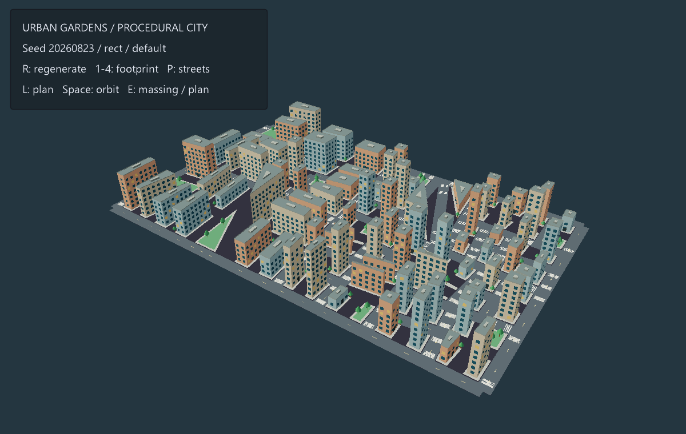

# Urban Generator example

Interactive showcase of the **`mesh.urban`** / **`urban.parcels`** procgen
algorithms — an engine port of the Eurographics 2024 paper *Hierarchical
Co-generation of Parcels and Streets in Urban Modeling* (Chen, Song & Ortner,
CGF 43(2), [10.1111/cgf.15053](https://doi.org/10.1111/cgf.15053)).

Run:

```sh
make run/win32-debug GAME=examples/urban-generator
# or, from inside this directory:
../../build/win32-debug/src/engine/eve.exe run
```

## What it generates

From a user-specified land polygon the generator co-produces a parcel mesh and a
connected street network in two stages, exactly as the paper describes:

1. **Hierarchical co-generation** — at every level each splittable parcel is
   binary-partitioned by the best of ~20 streamline candidates (a cross field
   aligned with the boundary, smoothed over the parcel, then traced), scored by
   the paper's quality metric `Q = λ1·Q_size + λ2·Q_regularity + λ3·Q_access`
   (Eq. 2). Short edges in the parcel mesh are removed by vertex merging.
   Unreachable parcels are grouped and given street access: an I-shaped or
   L-shaped access along parcel boundaries plus a turn-aware Dijkstra connection
   to the existing street network (Section 4).
2. **Global geometric optimization** — vertex positions are relaxed with the
   five-term energy of Eq. (3) (parcel regularity, side smoothness, street
   smoothness, right-angle junctions, closeness), constrained to preserve the
   land boundary. A built-in rollback keeps the initial layout when the
   relaxation cannot improve it.

Two output paths are exposed on `eve.Procgen()`:

- `generate("urban.parcels", p)` → Result whose `value` is a `Grid2D` with `Semantic::Road` streets,
  `Semantic::Floor` parcels (per-parcel id in `getDetail`), parcel anchor
  objects and metadata.
- `buildMesh("mesh.urban", p, gfx)` / `generateMesh(...)` → Result whose `value` is a flat or extruded
  parcel blocks + street ribbons, ready for the 3D renderer.

## Parameters

| param | default | meaning |
|-------|---------|---------|
| `land` | `rect` | `rect` / `triangle` / `ellipse` / `l` / `hexagon`, or explicit `x,y;x,y;...` points |
| `landWidth`, `landHeight` | 100 / 60 | preset land size |
| `minParcelArea` | 4 | minimal allowed parcel area (termination condition) |
| `targetParcels` | 120 | desired parcel count (0 = split until no parcel is splittable) |
| `maxLevels` | 10 | hierarchy depth cap |
| `lambdaSize/Regu/Acce` | 0.3 / 0.5 / 0.2 | Eq. (2) weights (parcel shape control) |
| `streetPattern` | `default` | `default` / `loop` / `culdesac` / `tree` |
| `boundaryStreet` | `all` | `all` / `none` / `random` land-boundary streets |
| `orientation` | `none` | `none` / `east-west` / `north-south` parcel orientation |
| `optimize` | 1 | run the global geometric optimization |
| `cellSize` (grid) / `extrude` (mesh) | 1 / 0 | raster resolution / block height |

Controls: `R` reseed, `1..4` land presets, `P` street pattern, `O` optimization,
`[`/`]` parcel count, `-`/`=` parcel size, `E` extrusion, `L` overhead plan view.

## Detailed street scene (2026-11-11)



The default scene uses 68 target parcels, a 2.8-unit street width, 2-unit building
setbacks and a 7.5-unit base building height. Cream stone, blue-grey and terracotta
facades share dark glass windows, occasional warm window panes, entrance doors,
roof cornices and roof service caps. Paved sidewalks separate the buildings from
asphalt roads with dashed center lines and zebra crossings at connected junctions.
Selected parcels become lawns with faceted trees; other trees stand in setbacks.

The paused diagonal overview frames the complete land polygon. `Space` starts or
stops orbiting; `L` switches to the overhead plan; `E` toggles the detailed scene
and flat parcel view. Reseeding, land presets and street-pattern changes rebuild
both the planning mesh and its details. The HUD sits above the skyline.

Recipe parameters `parcelInset`, `heightVariation`, `vertexColors` and
`presentationDetails` default to 0, 0, false and false, respectively. This example
enables all four. Detail geometry uses the same seed and parcel/street layout,
shares one output mesh, and requires no downloaded textures or external assets.
The mesh metadata reports `detail.windows`, `detail.trees`, `detail.parks`,
`detail.markings` and `detail.crossings`. Presentation details are disabled for
flat output. Existing consumers keep their original geometry until they opt in.

Setback clips against inward edge half-planes. A concave parcel uses its convex
kernel; parcels without a buildable kernel are omitted and counted in
`omittedFootprints`. The target parcel count describes planning subdivisions,
not the final building count (some subdivisions become parks).

[Opposite view](../../docs/images/examples/review-2026-11-11/urban-detail/opposite.png)
· [Overhead](../../docs/images/examples/review-2026-11-11/urban-detail/plan.png)
· [Triangle](../../docs/images/examples/review-2026-11-11/urban-detail/triangle.png)
· [Ellipse](../../docs/images/examples/review-2026-11-11/urban-detail/ellipse.png)
· [Another seed](../../docs/images/examples/review-2026-11-11/urban-detail/reseed.png)
