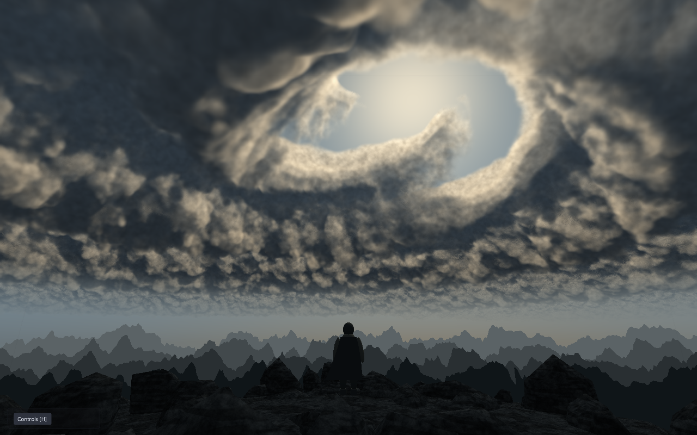

# Sky vortex / 仰视天空漩涡

人物站在岩脊上仰望巨大的天空漩涡。原生 3D 摄像机、人物/披风/岩石网格与程序化体积云组成场景；概念图仅作美术参考，没有作为天空贴图使用。

```powershell
eve run examples/vortex-cloud
```

也可运行 `make run/win32-debug GAME=examples/vortex-cloud`。
默认隐藏面板，点击左下角 Controls 或按 **H** 显示/隐藏控制。面板提供旋转速度（含反转）、卷曲、密度、风眼、细节尺度、摄像机仰角、采样数和云墙张开程度；Pause 冻结，Reset 恢复默认。

## Shader

- `shaders/vortex.frag`：世界空间云层射线步进，螺旋坐标流动、三维 FBM/胞状噪声密度、向下张开的云层内壁、光学透射及三点遮蔽近似。世界长度为示例单位。
- 光线由原生摄像机位置与天空网格世界位置计算，仰角变化后透视一致；天空盒在摄像机远裁剪面以内，人物/岩地用正常深度测试遮挡天空。
- `cloud-noise.tga`：固定种子的 64³ 三维数据，打包为带周期边框的 528×528 图集；红通道为大尺度 FBM，绿通道为胞状云团，蓝通道为细节。XY 由硬件过滤，Z 显式插值，不能当作普通颜色贴图生成 mipmaps。
- `shaders/rock.frag`：程序颗粒和岩层纹理。
- 旋转相位由 `eve_update(dt)` 积分，改变速度不会跳变。每个采样数配置固定，无随机时间闪烁；GPU 浮点噪声仅承诺视觉近似，不承诺跨设备逐像素一致。
- 网格和材质在初始化时创建并保留至场景结束；每帧仅更新相位、参数和摄像机。没有新增引擎 API、模块、持久化格式或跨域生命周期。

重编译后重启示例：

```powershell
glslc examples/vortex-cloud/shaders/vortex.frag -o examples/vortex-cloud/shaders/vortex.frag.spv
glslc examples/vortex-cloud/shaders/rock.frag -o examples/vortex-cloud/shaders/rock.frag.spv
```

SPIR-V 已提供，运行不需要编译器；面向 Vulkan。主 shader 使用标准 mesh 顶点接口。前九个 push-constant float 依次为相位、速度、卷曲、密度、风眼半径、细节尺度、仰角、采样数、云墙张开程度。速度在脚本积分，仰角由原生摄像机执行，这两槽保留与面板声明顺序对应。

## 质量与验证

默认 192 次采样，面板范围 64–256；非均匀步长将更多样本放在近侧云层。体积云是高开销全屏效果，低配设备可减少采样数或窗口分辨率。当前是可运行的视觉原型：人物和岩地为程序网格，云层细节、远处采样与光照仍未达到概念图品质；没有使用多重散射、时域重建或真实大气模型。

`python scripts/check_examples.py` 检查目录；`MIN_RUN_SECONDS=2 bash scripts/smoke_examples.sh vortex-cloud` 检查运行。引擎 MCP `eve_screenshot` 截帧验证云层随时间变化、暂停后稳定。概念图及生成提示词保存在 `references/`；`renders/preview.png` 是引擎 MCP 实拍。动态 GIF 是本地验证产物，位于原开发工作区 `output/vortex-cloud/`。

重新生成三维噪声需要 NumPy 与 Pillow：`python examples/vortex-cloud/generate_noise.py`。使用固定种子 22026，运行示例不依赖 Python。已检查重复生成字节一致及 64 个切片的周期边框。

## 渲染对照

当前引擎实拍：



美术概念参考（内置 imagegen 生成；不是运行时贴图）：


