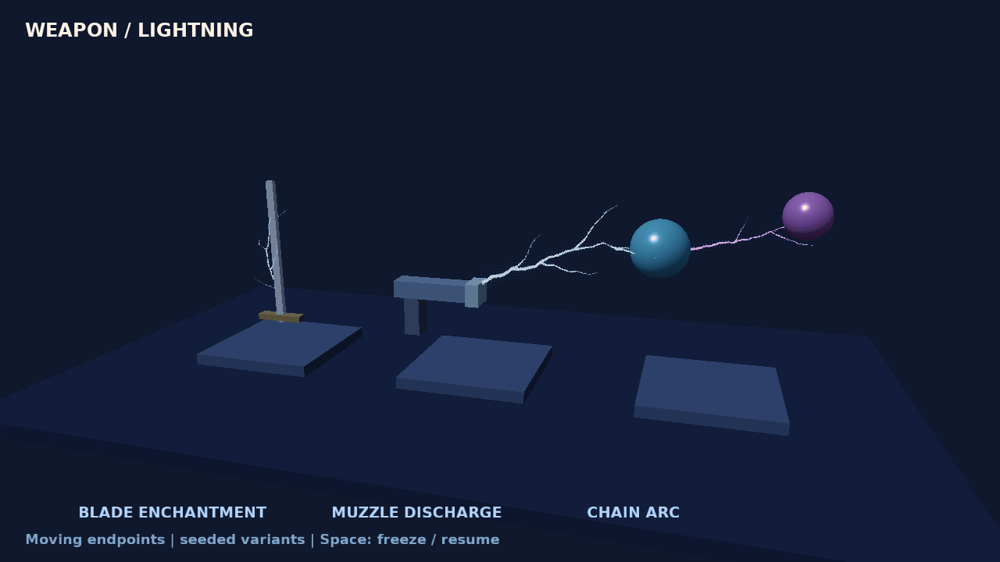

# Weapon lightning

Run `make run/win32-debug GAME=examples/weapon-lightning` (or `eve run examples/weapon-lightning`). Requires a build containing the reusable Lightning API.

The scene automatically pulses three independent instances: lightning along a moving sword blade, muzzle-to-moving-target discharge, and a purple chain hop. Space freezes/resumes motion and pulse time. No weather update is required and no global lighting/fog is changed.

```squirrel
local settings = eve.LightningSettings();
settings.width = 0.08;          // world-space half-width
settings.displacement = 0.45;   // world-space lateral displacement
settings.branches = 4;
settings.subdivisions = 5;
settings.duration = 0.5;        // seconds for one double-pulse envelope
settings.variants = 4;          // prebuilt shapes, cycled on trigger
settings.seed = 42;
local result = weather.prepareLightning(gfx, settings);
if (!result.ok) throw "Lightning preparation failed";
local lightning = result.value;
local endpoints = lightning.setEndpoints(0.0,1.0,0.0,5.0,2.0,0.0);
if (!endpoints.ok) throw "Invalid endpoints";
local started = lightning.trigger();
if (!started.ok) throw "Lightning start failed";
// Each update, copy current weapon socket and target positions to setEndpoints,
// check its Result, then check lightning.update(dt) before gfx.render3D().
```

`setColor(r,g,b)` tints the existing blue-white core/halo (RGB [0,16]); `stop()` hides immediately. Set endpoints again each frame to follow a socket or bone. Create one pooled instance per simultaneously visible arc; trigger replaces that instance's active pulse. Prepare off the hot path. Geometry/GPU uploads occur only during preparation, not on triggers or endpoint updates.

The effect is presentation only. Weapon hit detection, range checks, chain selection and damage remain in the weapon/combat systems; use their confirmed hit positions as endpoints. Never infer hits from visual branches.

Settings are copied at preparation. Width stays constant when endpoint distance changes; displacement is in the effect's local perpendicular plane. Reprepare to change shape settings. Seed and variant determine geometry; supplied dt controls age. Same-platform seeded CPU geometry is exact; cross-backend pixels are not promised bit-identical.

Instances own an internal generation-checked render entity and release it, meshes and shader on disposal. Graphics retirement detaches the entity before resource release. If an external ECS reset removes it, mutating methods return StaleHandle; recreate the instance after world reload. The VM owns returned script instances. Call stop before dropping the last reference if immediate disappearance is needed before GC. All calls and destruction belong on the engine render/update thread, outside ECS render traversal. No callbacks, serialization or weapon references are retained.



The preview is a sampled sequence of real engine-owned Vulkan captures, not a real-time frame-rate measurement. The lab explicitly uses the forward path without scene post-processing so the arc colors and thickness are easy to compare.
