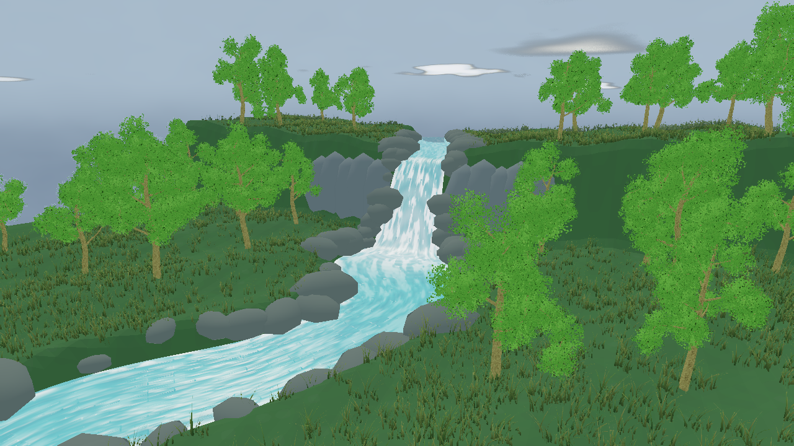

# Living Sky — Spline Falls & River



Unified `daynight` + `weather` showcase inspired by stylized Unity environment
lighting demos. It couples the solar/lunar cycle, procedural atmosphere,
volumetric clouds, height fog, precipitation, lightning exposure and scene
ambient light instead of letting independent modules overwrite one another.
A continuous Catmull-Rom spline carries water from the upper stream, over the
cliff and through a winding river. The same sampled centerline carves the
heightfield and places bank stones. A scene-owned water shader adds moving
whitewater, broken shoreline foam, impact rings and directional highlights.
Water and foam respond to the current daylight; rain increases the flow speed.
Vegetation is generated entirely with EVEngine: five seeded `mesh.tree`
variants use realistic Weber-Penn branching, leaf clusters and a generated
`tex.tree_atlas` for separate bark and leaf colours. Terrain-rooted procgen
point sets drive a scene-owned 3D grass mesh generator. Each blade has four
folded cross-sections and a single pointed tip (13 vertices / 14 triangles),
with randomized height, width, azimuth, curvature and olive-green tint. Broad
and fine density patches leave natural openings; placement avoids water and
steep slopes. The current seeds produce 40,002 blades in one shared mesh.
No grass billboards or grass textures are used. A vertex shader bends the tips
in weather-driven wind while roots stay fixed; the fragment shader darkens roots
and follows scene lighting. No external tree models are loaded.

```sh
eve run examples/weather-daynight
```

- `1`–`5`: clear, cloudy, rain, storm, snow
- `Space`: pause the clock
- `Left` / `Right`: scrub time
- `S`: force lightning
- `C`: toggle orbit camera (starts with a fixed waterfall composition)
- `G`: show/hide the sampled spline centerline

Edit the `anchors` array in `river.nut` to change position, elevation and
half-width. Restart the example after changing anchors or shader source.
The mesh is baked once (241 sections, 13 vertices per section); cumulative
3D distance supplies the downstream UV, so uneven anchor spacing does not
stretch the animation. Terrain, rocks and trees are also built only at startup.
`vegetation.nut` owns the native vegetation recipes, deterministic seeded
placement and weather wind updates. Mesh variants and the tree atlas are shared;
placement and mesh generation happen only at startup. Only time and wind
uniforms change each frame; grass vertex/index buffers are not rebuilt. Grass roots
sample the rendered heightmap, rather than an independent terrain approximation.
Animation uses the injected `dt`; placement uses fixed seeds.
This is an artistic flowing surface, not a fluid solver or a replay format.

`shaders/river.frag` and `shaders/grass_blades.vert` / `.frag` are example-owned
Vulkan GLSL shaders, compiled at startup by `gfx.newMeshShader` /
`gfx.newMeshShaderVF`; `glslc` must be available on PATH. The water material
uses the transparent forward queue with depth writes and opaque fragment alpha,
so the G-buffer does not replace its animated surface with plain albedo. This
example has been exercised on native Windows Vulkan; WebGPU is not supported
by these custom GLSL materials.

References used for the technique (the shader is authored for EVEngine):

- [Epic: water bodies and spline width/velocity](https://dev.epicgames.com/documentation/en-us/unreal-engine/water-body-actors-in-unreal-engine)
- [Catlike Coding: directional flow and aligned water patterns](https://catlikecoding.com/unity/tutorials/flow/directional-flow/)
